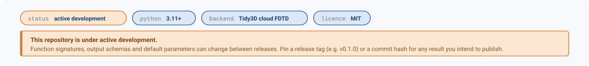
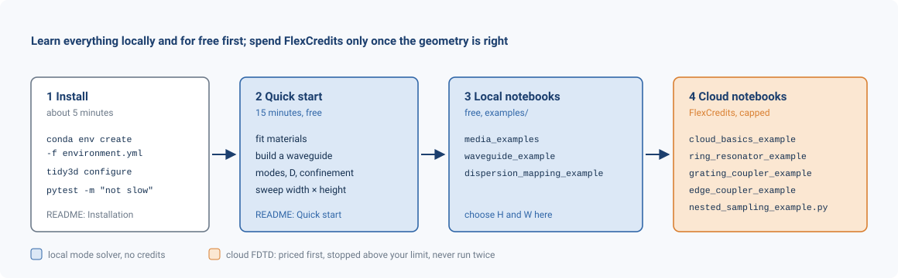
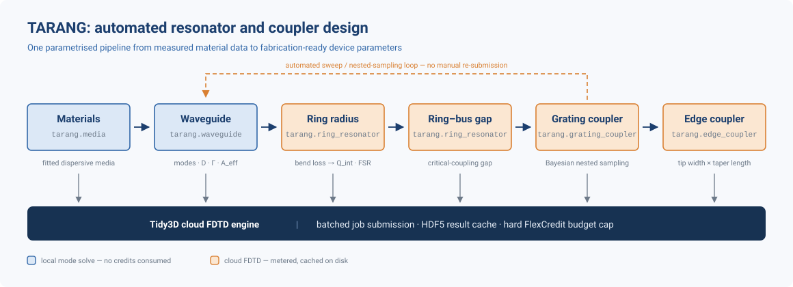
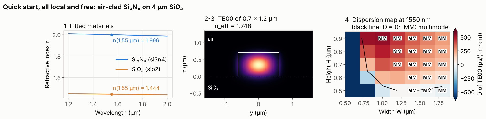
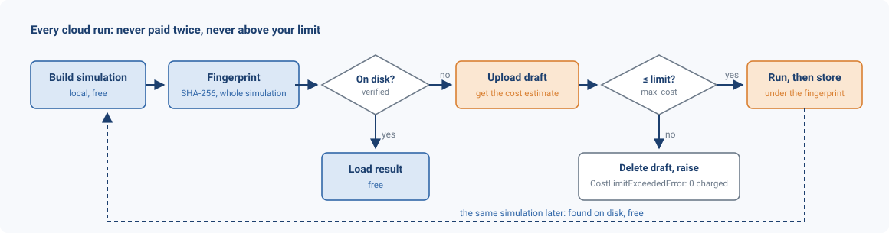
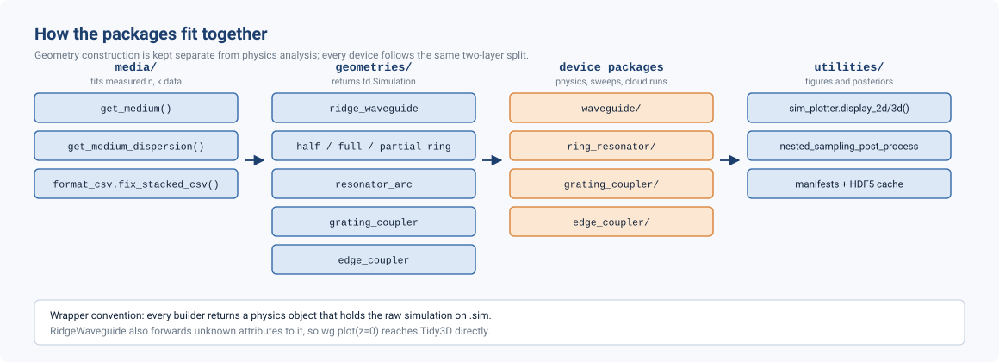

<div align="center">

# TARANG

**T**oolkit for **A**utomated **R**esonator **A**nalysis and **N**onlinear-comb **G**eneration

</div>

<p align="center">
  
</p>

TARANG designs integrated photonic devices on the [Tidy3D](https://docs.flexcompute.com/projects/tidy3d/)
mode solver and FDTD engine: from measured refractive-index data to waveguide, ring-resonator and
coupler parameters, with material fitting, sweeps, result caching, cost limits and Bayesian
optimisation built in. The current focus is silicon-nitride microresonators for Kerr frequency
combs. Record the TARANG version (or commit) and the `tidy3d` version with every result you
publish.

| Section | What it gives you |
|---|---|
| [Where to start](#where-to-start) | the path from installation to your first cloud run |
| [Pipeline](#pipeline) and [Capabilities](#capabilities) | what each stage computes, and which stages cost credits |
| [Installation](#installation) | one block of commands |
| [Quick start](#quick-start-local-no-credits) | five steps, all local and free, with the figures they produce |
| [Guided design](#guided-design-one-command) | one command from materials to GDS, at any wavelength |
| [Cloud runs and cost control](#cloud-runs-and-cost-control) | caching, cost limits, resuming |
| [Materials](#materials), [Logging](#logging), [Repository layout](#repository-layout) | reference, including the two `tarang.migrate` commands for old scripts |
| [Known limitations](#known-limitations), [Troubleshooting](#troubleshooting) | what to watch for, and fixes for common errors |
| [Contributing, citing, licence](#contributing-citing-licence) | how to contribute, what to cite, MIT licence; changes per release in [CHANGELOG.md](CHANGELOG.md) |

---

## Where to start

<p align="center">
  
</p>

## Pipeline

<p align="center">
  
</p>

Material fits set the waveguide dispersion; the waveguide's group index sets the ring's FSR; the
intrinsic *Q* from the radius sweep sets the coupling target for the gap sweep. Blue stages use
the **local** mode solver and are free; orange stages run **cloud FDTD**, paid in FlexCredits.
Settle a geometry in the blue stages before running orange ones.

## Capabilities

| Stage | What it produces | Entry point |
|---|---|---|
| Materials | Pole-residue media fitted to measured *n*, *k*; cached | `tarang.media.get_medium`, `get_medium_dispersion` |
| Waveguide | *n*<sub>eff</sub>, TE/TM labels, *D* [ps/(nm·km)], Γ, *A*<sub>eff</sub> | `tarang.waveguide.RidgeWaveguide` |
| Waveguide sweeps | Width × height maps of modes, dispersion, confinement | `tarang.waveguide.modes_in_geometry`, `dispersion_in_geometry`, `confinement_in_geometry` |
| Dispersion mapping | Converged *D* maps, *D*(λ), *D*<sub>int</sub>, finalist reports (command line) | `tarang.waveguide.dispersion_mapping` ([README](tarang/waveguide/dispersion_mapping/README.md)) |
| Rings | Full, half and partial rings; FSR, group index, mode fluxes | `tarang.ring_resonator.RingResonator`, `HalfRingResonator`, `PartialRingResonator` |
| Ring radius | Bend loss over arc angles, *Q*<sub>int</sub>, FSR | `tarang.ring_resonator.ring_radius_sweep.radius_sweep` |
| Ring–bus gap | Coupling against gap, critical-coupling gap | `tarang.ring_resonator.ring_gap_sweep.ring_gap_sweep`, `radius_gap_sweep` |
| Grating coupler | 2D/3D coupling efficiency; nested-sampling design search | `tarang.grating_coupler.GratingCoupler`, `tarang.grating_coupler.nested_sampler` |
| Edge coupler | Inverse-taper efficiency; tip × taper sweep | `tarang.edge_coupler.EdgeCoupler`, `tarang.edge_coupler.parametric_optimization_sweep` |
| Plots | Geometry views, corner plots | `tarang.utilities.sim_plotter`, `tarang.utilities.plot_corner` |
| Guided design | All stages in one session: cross-section, ring, gap, grating coupler, GDS, report | `python -m tarang.design` |

---

## Installation

Python 3.11 or newer on Windows, Linux or macOS. TARANG is installed from this repository
(not from PyPI), in editable mode, so local edits take effect immediately.

```bash
git clone https://github.com/loqm/tarang
cd tarang
conda env create -f environment.yml      # environment "tarang", with all extras
conda activate tarang
```

Without conda, into an existing environment: `pip install -e ".[plots,notebooks]"`.

| Extra | Adds |
|---|---|
| (none) | `tidy3d` ≥ 2.12, < 3; `numpy`, `pandas`, `pydantic`, `matplotlib`, `dynesty` |
| `[plots]` | `getdist`, `corner` (posterior plots) |
| `[notebooks]` | `jupyterlab`, `ipykernel`, `ipython` |
| `[layout]` | `gdstk` (GDS export of the guided design) |
| `[test]` | `pytest`, `pytest-cov`, plus `[plots]` and `[layout]` |
| `[multinest]` | `pymultinest` (needs the MultiNest library, below) |

Then, once per machine:

```bash
tidy3d configure                                   # Tidy3D API key, needed for cloud runs only
python -m ipykernel install --user --name tarang --display-name "TARANG"
python -m pytest -m "not slow"                     # check: about a minute, no credits
```

Optional, Linux and macOS only: `conda install -c conda-forge multinest pymultinest` adds the
MultiNest sampler; otherwise the nested sampler uses dynesty. After pulling new code, run
`conda env update -f environment.yml`.

---

## Quick start (local, no credits)

Everything here runs on your computer; files are written relative to the current folder.
Steps 1–4 produce the three results below (generated by `docs/make_readme_figures.py`).

<p align="center">
  
</p>

**1. Fit the materials.**

```python
from tarang.media import get_medium, get_medium_dispersion

SiN = get_medium("si3n4", wl_range=(1.35, 1.75))
SiO2 = get_medium("sio2", wl_range=(1.35, 1.75))

get_medium_dispersion("si3n4", output_path="example_results/si3n4_dispersion.png",
                      wl_range=(1.35, 1.75), force_zero_k=True)
```

Fits are cached in `~/.cache/tarang/fitted_media` (change with `TARANG_CACHE_DIR`) and reused
by later calls; `use_cache=False` forces a refit. Fit over the band you will simulate.

**2. Build a waveguide.**

```python
from tarang.geometries import ridge_waveguide
from tarang.utilities.sim_plotter import display_3d

wg = ridge_waveguide.get_passive_simulation(
    width=1.2, height=0.7, length=2.0,
    core_medium=SiN, box_medium=SiO2, box_height=4.0,
    wavelength_um=1.55,
    fine_steps_per_wvl=50,      # converged dispersion needs >= 50 (default 20 is ~25 % off)
)

display_3d(wg, output_path="example_results/waveguide_geometry.png", show=False, save=True)
```

Lengths are in µm. Layer arguments are the same for every device: `core_medium`;
`box_medium`, `box_height` (buried oxide); `top_cladding_medium`, `top_cladding_height` (air
if omitted); `handle_medium`, `handle_height` (Si wafer, grating coupler only).
`get_active_simulation` also adds a mode source and monitors for FDTD.

**3. Compute the mode physics.**

```python
modes = wg.get_modes(num_modes=4)     # n_eff, TE fraction, TE/TM label, guided flag
disp = wg.get_dispersion()            # D [ps/(nm km)], regime, single-mode flag
conf = wg.get_confinement()           # Γ and A_eff [µm²] of the TE00 mode
```

**4. Sweep the cross-section.**

```python
from tarang import waveguide

waveguide.dispersion_in_geometry(
    sweep_heights=[0.6, 0.8],
    sweep_widths=[0.9, 1.2, 1.5, 1.8],
    core_medium=SiN, box_medium=SiO2, box_height=4.0,
    wavelength_um=1.55,
    output_dir_name="example_results/dispersion_sweep",
)
```

`modes_in_geometry` and `confinement_in_geometry` take the same arguments. For converged maps,
*D*(λ) and finalist selection, use the [dispersion-mapping tools](tarang/waveguide/dispersion_mapping/README.md):

```bash
python -m tarang.waveguide.dispersion_mapping.sweep --heights 0.60:0.90:0.05 --widths 0.6:1.6:0.1
```

**5. Continue with the notebooks** in `examples/`, in this order (stored without outputs;
each starts with a table of the functions it shows):

| Notebook | Covers | Credits |
|---|---|---|
| `media_examples.ipynb` | material fits against published data | none |
| `waveguide_example.ipynb` | modes, Γ, *D*, *D*(λ), guided-mode check, width × height sweeps | none |
| `dispersion_mapping_example.ipynb` | choosing *H* and *W*: design map, mesh convergence, tolerance report, *D*<sub>int</sub> | none |
| `cloud_basics_example.ipynb` | fingerprints, cache, cost limits (one optional capped run) | none by default |
| `ring_resonator_example.ipynb` | ring geometries, FSR, bend loss and *Q*<sub>int</sub>, critical-coupling gap | yes, capped |
| `grating_coupler_example.ipynb`, `edge_coupler_example.ipynb` | coupler efficiency, fields, taper sweep | yes, capped |
| `nested_sampling_example.py` | Bayesian grating-coupler search | yes, capped |

---

## Guided design (one command)

`python -m tarang.design` runs the whole pipeline as one session, for any wavelength the
material data cover:

```
materials -> cross-section (H x W) -> ring (radius, Q, D_int) -> ring-bus gap -> grating coupler -> layout -> report
   local           local                    local                  cloud            cloud           local     local
```

Each stage asks only what it needs (the default is shown; Enter accepts it), then prints
its results and saves its figures and tables. Cloud stages first show the FlexCredit
estimate and wait for your confirmation. Your answers are saved in `design.toml`, so the
same design can be repeated, or continued after a stop, without questions:

```bash
python -m tarang.design                                     # asks everything
python -m tarang.design --config design_runs/my_ring/design.toml --yes   # repeat, no questions
python -m tarang.design --config design_runs/my_ring/design.toml --only grating --redo grating
python -m tarang.design --list                              # the stages
```

| Stage | Asks for | Produces |
|---|---|---|
| Materials | wavelength, core, box, cladding (a key, or your own CSV of measured *n*, *k*) | fitted *n*(λ), *k*(λ) table and plot |
| Cross-section | film thickness if fixed, map ranges, tolerances | design map, ranked candidates, tolerance and mesh check of your choice |
| Ring | FSR target, losses | radius, *Q*<sub>int</sub>, bend loss, *D*(λ), *D*<sub>int</sub> |
| Gap | gaps, over-coupling ratio | critical and over-coupled gap, loaded *Q* |
| Grating coupler | etch (full or partial), fibre angle and MFD | period, fill factor and fibre position from a priced sweep; optional 3D check |
| Layout | layer numbers, tone (structure or trench) | `waveguide.gds`, `ring_waveguide.gds`, `ring_waveguide_gc.gds`, `parameters.json`/`.m`/`.csv` |
| Report | | `report.md`, `design_summary.json`, `tables/check_values.csv` |

`tables/check_values.csv` lists every number the design rests on with how it was computed,
and `tables/materials_nk.csv` the fitted material data, so the design can be checked in any
other solver. GDS export needs the `layout` extra (`pip install -e ".[layout]"`; included in
`environment.yml`).

---

## Cloud runs and cost control

<p align="center">
  
</p>

* **Cached by simulation.** Each result is stored under a SHA-256 fingerprint of the complete
  Tidy3D simulation, next to its `simulation.json`, in the output folder you pass. An identical
  simulation is loaded from disk; any change, including a material, runs again. Results are
  never overwritten.
* **Priced before it starts.** A job whose estimate exceeds its limit is deleted unstarted and
  raises `CostLimitExceededError`. Set the limit per device (`device.max_cost = 0.5`), per
  batch (`parametric_optimization_sweep(..., max_cost=...)`), or for the whole session with
  the environment variable `TARANG_MAX_COST`, which also covers sweeps that build devices
  internally.
* **Sweeps resume.** Cached points are skipped; `force_rerun=True` recomputes.
* **Capped optimisation.** The nested sampler stops before exceeding `credit_limit` and
  returns `status="PAUSED_BUDGET_EXCEEDED"`; raise the limit and rerun in the same folder to
  continue from the cache.

Start in 2D (`is_3d=False` for grating couplers) with a coarse mesh; refine once the geometry
is right.

---

## Materials

| Key | Material | Range (µm) |
|---|---|---|
| `si3n4` | Stoichiometric Si₃N₄ (Luke 2015) | 0.31 – 5.50 |
| `si3n4_hong` | LPCVD SiN (Hong 2021) | 0.42 – 1.63 |
| `sio2` | Fused silica (Malitson 1965) | 0.40 – 3.00 |
| `sio2_nyakuchena` | Silica microspheres (Nyakuchena 2023) | 1.10 – 1.65 |
| `si` | Crystalline Si film, 25 °C (Wang 2025) | 0.40 – 1.31 |
| `si_franta` | Float-zone c-Si, 300 K (Franta 2017) | 0.03 – 310 |
| `air` | n = 1 | any |

Choose a dataset whose range covers your whole simulation band; outside it the fit is an
extrapolation and TARANG warns. Your own measured data (for example ellipsometry of your
film) can be used directly by path: `get_medium("data/my_film.csv", wl_range=(1.3, 1.8))`,
with columns `wl` (µm), `n` and optionally `k`. References, recommendations per wavelength and how to add a
material: [SOURCES.md](tarang/media/data/SOURCES.md).

## Logging

```python
from tarang import configure_logging, set_tidy3d_log_level

configure_logging("INFO")                          # to the console
configure_logging("INFO", log_file="run.log")      # and to a UTF-8 file
set_tidy3d_log_level("WARNING")                    # Tidy3D's own messages
```

---

## Repository layout

<p align="center">
  
</p>

```
tarang/                 the Python package
├── media/              material data, fitting and cache
├── geometries/         Tidy3D simulation builders (no analysis)
├── waveguide/          RidgeWaveguide, sweeps, dispersion_mapping/
├── ring_resonator/     ring classes, radius and gap sweeps
├── grating_coupler/    GratingCoupler, nested sampler
├── edge_coupler/       EdgeCoupler, taper sweep
├── utilities/          cloud runs (cache, cost guard), samplers, plotting
├── design/             python -m tarang.design: the guided design tool
└── migrate.py          updates scripts written for the old layout
examples/               notebooks and nested_sampling_example.py
tests/                  test suite (tests/README.md)
docs/                   figures
```

Builders in `tarang.geometries` return a wrapper holding the `td.Simulation` on `.sim`; the
analysis lives in the device package.

### Upgrading old scripts

Before v0.1.0 the packages were top-level (`from media import ...`, `import gratingCoupler`).
This rewrites the imports in your scripts and notebooks; the rest of the code needs no change:

```bash
python -m tarang.migrate path/to/your/scripts            # dry run: shows the changes
python -m tarang.migrate path/to/your/scripts --write    # apply
```

---

## Known limitations

* **Fitted materials make fingerprints machine-specific.** Fits differ between operating
  systems in the last digits, so a cache copied between Windows and Linux is not reused.
* **Deprecated names** (`ringResonator`, `sub_medium`, ...) work with a warning until v0.2.0
  ([CHANGELOG.md](CHANGELOG.md#upgrading-from-pre-010-code)).
* **Tidy3D 2.x only**, tested with 2.12. **MultiNest** is not available on Windows (dynesty is
  used).
* The resonator-arc builder triggers Tidy3D's warning `Override structures should be 'Box'`.
  Results are unaffected; it is kept so that cached arc results remain valid.

## Troubleshooting

| Symptom | Fix |
|---|---|
| `No module named 'media'` (or `geometries`, `gratingCoupler`, ...) | Old layout: run `python -m tarang.migrate` ([Upgrading old scripts](#upgrading-old-scripts)). |
| `No module named 'tarang'` | Activate the environment, or run `pip install -e .` in the repository. |
| A dependency is found only in some runs | It is in your user folder, not the environment: `python -s -m pip install <package>`. |
| `No Tidy3D API key found` | Run `tidy3d configure` (or set `SIMCLOUD_APIKEY`). |
| `CostLimitExceededError` | Estimate above `max_cost` / `TARANG_MAX_COST`; nothing was charged. Raise the limit or coarsen the mesh. |
| `WaveguideModeError: TE00 mode not found` | Widen the core, raise `num_modes`, or enlarge `sim_size_y` / `sim_size_z`. |
| `No guided modes` in the log | Below cut-off; `require_guided=True` makes it an error. |
| `ValueError: sim_size_z (...) must exceed ...` | The vertical domain is smaller than box + core + cladding; enlarge `sim_size_z`. |
| `Requested wl_range ...` (no data / beyond the data) | Pick a dataset that covers the band ([Materials](#materials)). |
| A sweep returns instantly | Every point is cached; `force_rerun=True` recomputes. |
| `DeprecationWarning: ... removed in TARANG v0.2.0` | Use the new name given in the message. |

---

## Contributing, citing, licence

**Contributing:** [CONTRIBUTING.md](CONTRIBUTING.md) (setup, review rules, conventions, adding
a material or device); every pull request runs the tests on Linux and Windows
([tests/README.md](tests/README.md)).

**Citing:** cite TARANG using [CITATION.cff](CITATION.cff) (**Cite this repository** on GitHub);
a paper is in preparation. Also cite the material data you used
([SOURCES.md](tarang/media/data/SOURCES.md)), [Tidy3D](https://docs.flexcompute.com/projects/tidy3d/),
and for nested sampling [dynesty](https://dynesty.readthedocs.io/) (Speagle, *MNRAS* **493**,
3132 (2020)) or MultiNest (Feroz, Hobson & Bridges, *MNRAS* **398**, 1601 (2009)), and
[GetDist](https://getdist.readthedocs.io/) for posterior plots.

**Authors:** Esraaj Sarkar Gupta and Divyanshu Tiwari. Developed at the
[Laboratory of Optics of Quantum Materials (LOQM)](https://loqm.tech), Indian Institute of
Technology Bombay. **Licence:** MIT, © 2026 Laboratory of Optics of Quantum Materials
([LICENSE](LICENSE)).
