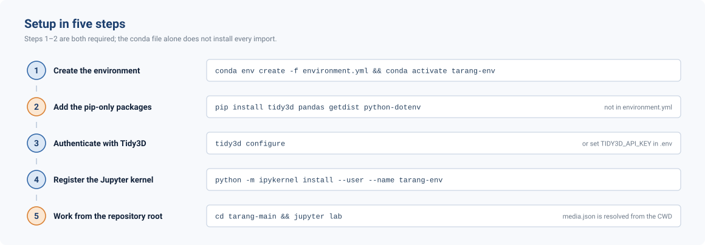

<div align="center">

# TARANG

**T**oolkit for **A**utomated **R**esonator **A**nalysis and **N**onlinear-comb **G**eneration

</div>

<p align="center">
  
</p>

> [!IMPORTANT]
> **TARANG is under active development.** Function signatures, returned dictionaries and
> default parameters can change between releases. For any result destined for a thesis or a
> paper, record the TARANG release (or commit hash) and the `tidy3d` version alongside it.
> See [CHANGELOG.md](CHANGELOG.md) for what changed in each release, and
> [§9 Known limitations](#9-known-limitations) before you rely on a result.

TARANG is a design and characterisation framework for integrated photonics, built on the
[Tidy3D](https://docs.flexcompute.com/projects/tidy3d/) FDTD and mode-solving backend. It takes
measured refractive-index data at one end and returns fabrication-ready device parameters at the
other, handling material fitting, parameter sweeps, result caching, cost control and Bayesian
optimisation for you. The current focus is silicon-nitride microresonators for Kerr frequency
combs and their input/output couplers.

---

## 1. The pipeline

<p align="center">
  
</p>

Each stage consumes the output of the one before it:
* the material fits set the dispersion used by the waveguide mode solver;
* the waveguide cross-section sets the group index, which predicts the FSR;
* the intrinsic *Q* from the radius sweep sets the coupling target for the gap sweep.

The dashed return path is the optimisation loop: sweeps and the nested sampler
re-parametrise the geometry and resubmit on their own.

The colour split matters for your budget. Blue stages run the **local** mode solver and cost
nothing; orange stages submit **cloud FDTD** jobs metered in FlexCredits. Develop a geometry
entirely in blue before spending anything on orange ([§5](#5-cloud-runs-and-cost-control)).

---

## 2. Capabilities

| Stage | What it produces | Entry point |
|---|---|---|
| Materials | Pole-residue media fitted to measured *n*, *k*; cached and hash-validated | `media.get_medium`, `media.get_medium_dispersion` |
| Waveguide | *n*<sub>eff</sub>, TE/TM labels, *D* [ps/(nm·km)], Γ, *A*<sub>eff</sub> | `waveguide.RidgeWaveguide` |
| Waveguide sweeps | Width × height maps of modes, dispersion and confinement | `waveguide.modes_in_geometry`, `dispersion_in_geometry`, `confinement_in_geometry` |
| Dispersion mapping | Robust *D* maps, mesh convergence, broadband *D*(λ) and *D*<sub>int</sub>, finalist reports (command line, local) | `waveguide.dispersion_mapping` ([README](waveguide/dispersion_mapping/README.md)) |
| Rings | Full, half and partial rings; FSR, group index, mode fluxes | `ring_resonator.RingResonator`, `HalfRingResonator`, `PartialRingResonator` |
| Ring radius | Bend loss by cutback over arc angles, *Q*<sub>int</sub>, FSR | `ring_resonator.ring_radius_sweep.radius_sweep` |
| Ring–bus gap | Coupling against gap, critical-coupling point | `ring_resonator.ring_gap_sweep.ring_gap_sweep` |
| Grating coupler | 2D/3D coupling efficiency; nested-sampling design search | `grating_coupler.GratingCoupler`, `grating_coupler.nested_sampler` |
| Edge coupler | Inverse-taper efficiency, insertion loss, tip × taper sweep | `edge_coupler.EdgeCoupler`, `edge_coupler.parametric_optimization_sweep` |
| Visualisation | Geometry slices and projections, corner plots | `utilities.sim_plotter`, `utilities.plot_corner` |

---

## 3. Installation

<p align="center">
  
</p>

TARANG runs on Windows, Linux and macOS with Python 3.11 or newer. It is installed from
this repository; it is not on PyPI.

### 3.1 With conda (recommended)

```bash
git clone https://github.com/loqm/tarang
cd tarang
conda env create -f environment.yml
conda activate tarang
```

This creates an environment called `tarang` with Python 3.11 and installs TARANG into it
in **editable** mode (`pip install -e`): the code stays in the folder you cloned, and
your edits take effect without reinstalling. It also installs the plotting, notebook
and test extras.

After pulling new code, update the environment with `conda env update -f environment.yml`.

### 3.2 With pip, into an existing environment

```bash
git clone https://github.com/loqm/tarang
cd tarang
pip install -e ".[plots,notebooks]"
```

| Extra | Adds |
|---|---|
| (none) | `tidy3d` (2.12 or newer, below 3), `numpy`, `pandas`, `pydantic`, `matplotlib`, `dynesty` |
| `[plots]` | `getdist`, `corner`, for posterior corner plots |
| `[notebooks]` | `jupyterlab`, `ipykernel`, `ipython` |
| `[test]` | `pytest`, `pytest-cov`, plus `[plots]` |
| `[multinest]` | the `pymultinest` wrapper (see §3.5) |

The distribution is called `tarang-photonics`; the import names are unchanged
(`import media`, `import geometries`, ...).

### 3.3 Tidy3D account

Cloud FDTD runs need a [Tidy3D](https://www.flexcompute.com/tidy3d/) API key. Store it once:

```bash
tidy3d configure
```

Alternatively, set the environment variable `SIMCLOUD_APIKEY`. Tidy3D reads only these two
places. Earlier TARANG documentation suggested `TIDY3D_API_KEY` in a `.env` file, which
Tidy3D never read; TARANG now passes `TIDY3D_API_KEY` (or `TIDY3D_KEY`) on to Tidy3D with
a warning, but `tidy3d configure` is the reliable way. Everything in §4 works without a key.

### 3.4 Jupyter kernel

```bash
python -m ipykernel install --user --name tarang --display-name "TARANG"
```

### 3.5 Optional: MultiNest

Nested sampling uses [dynesty](https://dynesty.readthedocs.io/) (pure Python, every OS) by
default. On Linux and macOS you can add the MultiNest backend from conda-forge, inside the
activated environment:

```bash
conda install -c conda-forge multinest pymultinest
```

`backend="auto"` then prefers MultiNest. Do not install `pymultinest` with pip alone: it
needs the compiled `libmultinest` library.

### 3.6 Check the installation

```bash
python -m pytest -m "not slow"      # about a minute, no FlexCredits
python -m pytest                    # full suite, a few minutes
```

[tests/README.md](tests/README.md) describes every test.

---

## 4. First run: about fifteen minutes, zero credits

Everything below runs on your computer with the local mode solver. No cloud job is submitted.
Files are written relative to the folder you run from.

**Step 1: fit the materials.**

```python
from media import get_medium, get_medium_dispersion

SiN = get_medium("si3n4", wl_range=(1.35, 1.75))
SiO2 = get_medium("sio2", wl_range=(1.35, 1.75))

get_medium_dispersion("si3n4", output_path="example_results/si3n4_dispersion.png",
                      wl_range=(1.35, 1.75), force_zero_k=True)
```

The first call fits a pole-residue model and caches it in your user folder
(`~/.cache/tarang/fitted_media`; set `TARANG_CACHE_DIR` to move it). The cache is keyed on
the CSV file's hash, wavelength range, pole count and tolerance, so later calls are
instant (`Cache HIT` in the log). Pass `use_cache=False` to force a refit.
`get_medium("air")` returns a dispersionless medium. Which material to use for which
wavelength is in [media/data/SOURCES.md](media/data/SOURCES.md).

**Step 2: build a waveguide and look at it.**

```python
from geometries import ridge_waveguide
from utilities.sim_plotter import display_3d

wg = ridge_waveguide.get_passive_simulation(
    width=1.2, height=0.7, length=2.0,
    core_medium=SiN, box_medium=SiO2, box_height=4.0,
    wavelength_um=1.55,
    fine_steps_per_wvl=50,      # converged dispersion needs >= 50 (default 20 is ~25 % off)
)

display_3d(wg, output_path="example_results/waveguide_geometry.png", show=False, save=True)
```

The layers have one name each across all devices:
* `core_medium`: the waveguide core;
* `box_medium` / `box_height`: the buried oxide under the core;
* `top_cladding_medium` / `top_cladding_height`: the cladding above (air if omitted);
* `handle_medium` / `handle_height`: the silicon wafer (grating coupler only).

All lengths are in µm. `get_passive_simulation` builds structures and mesh only;
`get_active_simulation` adds a mode source and monitors for an FDTD run.

**Step 3: extract the physics.**

```python
modes = wg.get_modes(num_modes=4)     # n_eff, TE fraction, TE/TM label, guided flag
disp = wg.get_dispersion()            # D [ps/(nm km)], regime, single-mode flag
conf = wg.get_confinement()           # Γ and A_eff [µm²] of the TE00 mode
```

These call Tidy3D's `ModeSolver` locally: free and fast. `wg.get_modes(require_guided=True)`
raises `WaveguideModeError` instead of returning when the geometry guides nothing.

**Step 4: map a design space.**

```python
import waveguide

waveguide.dispersion_in_geometry(
    sweep_heights=[0.6, 0.8],
    sweep_widths=[0.9, 1.2, 1.5, 1.8],
    core_medium=SiN, box_medium=SiO2, box_height=4.0,
    wavelength_um=1.55,
    output_dir_name="example_results/dispersion_sweep",
)
```

One figure per height, one point per width, with the normal and anomalous regions shaded.
`modes_in_geometry` and `confinement_in_geometry` take the same arguments. For
publication-grade maps (mesh convergence, *D*(λ), integrated dispersion, finalist
selection) use the command-line tools in
[waveguide/dispersion_mapping](waveguide/dispersion_mapping/README.md), for example:

```bash
python -m waveguide.dispersion_mapping.sweep --heights 0.60:0.90:0.05 --widths 0.6:1.6:0.1
```

**Step 5: then go to the cloud.** Work through the notebooks in this order:

| # | Notebook | Credits |
|---|---|---|
| 1 | `media_examples.ipynb`: material fitting, curves checked against published data | none |
| 2 | `waveguide_example.ipynb`: modes, dispersion, confinement, sweeps | none |
| 3 | `ring_resonator_example.ipynb`: ring geometries, type conversion, FSR, gap and radius sweeps | yes |
| 4 | `edge_coupler_example.ipynb`, `grating_coupler_example.ipynb`: input/output couplers | yes |
| 5 | `nested_sampling_example.py`: Bayesian grating-coupler design search | yes, capped |

---

## 5. Cloud runs and cost control

Cloud FDTD is metered. TARANG is built so that you never pay twice for the same result
and never pay more than you allowed.

* **Every result is cached by what was simulated.** The cache key is a SHA-256
  fingerprint of the complete Tidy3D simulation (geometry, materials, mesh, sources,
  monitors). The result is stored as `raw_simulation_data.hdf5` next to the
  `simulation.json` it came from, in a folder named after the device parameters plus the
  first characters of the fingerprint, inside the output directory you pass. A later request for the same simulation is served from
  disk, after checking that the stored simulation matches. Change anything, including a
  material, and the simulation runs again.
* **Results are never overwritten.** Downloads go to a temporary file first; folders from
  pre-v0.1.0 TARANG are reused only if their stored simulation matches, and are never
  modified.
* **Every run is priced first.** Before a job starts, Tidy3D's cost estimate is compared
  with `max_cost` (an argument of each device and sweep), or with the environment variable
  `TARANG_MAX_COST` for a session-wide limit. Above it, the job is deleted unstarted and
  `CostLimitExceededError` is raised; nothing is charged.
* **Sweeps resume.** Batch sweeps skip points already in the cache. The ring sweeps keep a
  manifest (`intrinsic_physics_manifest.json`, `analytic_coupling_manifest.json`); pass
  `force_rerun=True` to recompute.
* **The nested sampler has a hard budget.**
  `GratingCouplerBayesianOptimizer(..., credit_limit=...)` and
  `execute_search_with_budget(credit_limit=...)` stop before the simulation that would
  exceed the cap and return `status="PAUSED_BUDGET_EXCEEDED"`. Raise the limit and run
  again with the same output directory to resume. Re-evaluated points are free cache hits.
  `backend="auto"` uses MultiNest when installed and dynesty otherwise; both write the
  same chain files.

Start every device in 2D (`is_3d=False` for grating couplers) with a coarse mesh
(`fine_steps_per_wvl`, `coarse_steps_per_wvl`), and refine only once the geometry is sane.

---

## 6. Repository layout

<p align="center">
  
</p>

Every device follows the same two-layer split:
* `geometries/*` builds a raw `td.Simulation` and wraps it in a physics object;
* the device package holds the analysis.

Wrappers expose `.sim`. `RidgeWaveguide` also forwards unknown attributes to the
simulation, so `wg.plot(z=0)` reaches Tidy3D directly.

```
tarang/
├── pyproject.toml                  # package definition, dependencies and extras
├── environment.yml                 # conda environment (installs TARANG editable)
├── CHANGELOG.md  CONTRIBUTING.md  CITATION.cff  LICENSE
│
├── tarang/                         # shared infrastructure: version, logging, deprecation shims
├── media/                          # material models
│   ├── medium_helper.py            #   get_medium(), get_medium_dispersion()
│   ├── format_csv.py               #   reads stacked refractiveindex.info CSVs
│   ├── media.json                  #   material key -> CSV registry
│   └── data/                       #   n, k datasets and SOURCES.md
├── geometries/                     # Tidy3D simulation builders, no analysis
│   ├── ridge_waveguide.py          #   get_passive_simulation / get_active_simulation
│   ├── full_ring_resonator.py  half_ring_resonator.py  partial_ring_resonator.py
│   ├── resonator_arc.py  grating_coupler.py  edge_coupler.py
├── waveguide/                      # ridge-waveguide physics
│   ├── waveguide.py                #   RidgeWaveguide
│   ├── mode_sweep.py  dispersion_sweep.py  confinement_sweep.py
│   └── dispersion_mapping/         #   command-line dispersion engineering (local)
├── ring_resonator/                 # RingResonator, HalfRingResonator, PartialRingResonator,
│   ├── ring_radius_sweep.py        #   ResonatorArc; radius -> bend loss, Q_int, FSR
│   └── ring_gap_sweep.py           #   gap -> coupling regime
├── grating_coupler/                # GratingConfig, GratingCoupler; nested_sampler.py
├── edge_coupler/                   # EdgeCoupler; optimization_sweep.py
├── utilities/                      # cloud_run (cache, cost guard), nested_backends,
│                                   # sim_plotter, corner_plot, post-processing
├── tests/                          # pytest suite, see tests/README.md
├── docs/assets/                    # figures used by this README
├── *_example.ipynb                 # one notebook per device family
└── nested_sampling_example.py
```

`edgeCoupler/`, `gratingCoupler/` and `ringResonator/` are the pre-v0.1.0 package names,
kept as deprecated aliases until v0.2.0 ([CHANGELOG.md](CHANGELOG.md#upgrading-from-pre-010-code)).

---

## 7. Material data

| Key | Material | Range (µm) | Use at 1550 nm |
|---|---|---|---|
| `si3n4` | Stoichiometric Si₃N₄ (Luke 2015) | 0.31 – 5.50 | yes |
| `si3n4_hong` | LPCVD SiN (Hong 2021) | 0.42 – 1.63 | narrow band only |
| `sio2` | Fused silica (Malitson 1965) | 0.40 – 3.00 | yes |
| `sio2_nyakuchena` | Silica microspheres (Nyakuchena 2023) | 1.10 – 1.65 | narrow band only |
| `si` | Crystalline Si film, 25 °C (Wang 2025) | 0.40 – 1.31 | **no**, use `si_franta` |
| `si_franta` | Float-zone c-Si, 300 K (Franta 2017) | 0.03 – 310 | yes |
| `air` | n = 1 | any | yes |

Full references, sample details and the steps to add a material:
[media/data/SOURCES.md](media/data/SOURCES.md). In short: put a `wl,n[,k]` CSV
(wavelength in µm) in `media/data/`, register a lower-case key in `media/media.json`, and
document it in `SOURCES.md`. Source files are never modified by TARANG.

---

## 8. Logging

TARANG logs under the `tarang` logger. To see its messages:

```python
from tarang import configure_logging, set_tidy3d_log_level

configure_logging("INFO")                          # to the console
configure_logging("INFO", log_file="run.log")      # and to a UTF-8 file
set_tidy3d_log_level("WARNING")                    # Tidy3D's own messages
```

---

## 9. Known limitations

* **Cached results are machine-specific when fitted materials are used.** The material fit
  agrees between operating systems to about 15 digits but not bit for bit, so the same
  simulation built on Windows and on Linux can have different fingerprints, and a cache
  copied between them is not reused. Results built from the same machine's cache are
  unaffected.
* **Material ranges.** Outside its tabulated range a fitted index is an extrapolation;
  TARANG warns, but the check is yours (§7).
* **Generic top-level package names.** TARANG installs `media`, `utilities`, `geometries`,
  `waveguide`, ... as top-level packages, which can clash with other packages in the same
  environment. Moving them under `tarang.` is planned for v0.2.0.
* **Deprecated names** (pre-v0.1.0 package, class and parameter names) work with a
  `DeprecationWarning` until v0.2.0, then will be removed.
* **Tidy3D versions.** Tested with Tidy3D 2.12. Tidy3D 3.x is excluded until tested.
* **MultiNest** is not available on Windows; dynesty is used there.

---

## 10. Troubleshooting

| Symptom | Cause and fix |
|---|---|
| `ModuleNotFoundError: geometries` (or `media`, `waveguide`, ...) | TARANG is not installed in the active environment. Activate it, or run `pip install -e .` in the repository (§3). |
| `ModuleNotFoundError: dateutil` (or another dependency) only in some runs | The package is installed in your personal user folder, not in the environment. Run `python -s -m pip install <package>` inside the environment. |
| Warning: `No Tidy3D API key found` | Run `tidy3d configure` once on this machine (§3.3). |
| `CostLimitExceededError` | The job's estimate exceeds `max_cost` or `TARANG_MAX_COST`. Nothing was run or charged. Raise the limit or coarsen the mesh. |
| `WaveguideModeError: TE00 mode not found` | No TE-like mode in the solver window. Widen the core, raise `num_modes`, or enlarge `sim_size_y` / `sim_size_z`. |
| `"No guided modes"` in the log | *n*<sub>eff</sub> ≤ cladding index for every mode: the geometry is below cut-off. Use `require_guided=True` to make this an error. |
| `ValueError: sim_size_z (...) must exceed ...` | The vertical domain is smaller than box + core + cladding. |
| `Requested wl_range ... has ZERO data points` | The material's data does not cover that range at all (§7; e.g. `si` at 1550 nm). |
| Warning: `Requested wl_range ... extends beyond the data` | The fit is extrapolated outside the data. Narrow the range or choose another dataset. |
| Sweep returns instantly, no simulations | Every point is cached (or a manifest hit). Pass `force_rerun=True` to recompute. |
| `DeprecationWarning: ... renamed ... removed in TARANG v0.2.0` | Old name; the message gives the new one ([CHANGELOG.md](CHANGELOG.md#upgrading-from-pre-010-code)). |

---

## 11. Contributing and tests

See [CONTRIBUTING.md](CONTRIBUTING.md): development setup, branch and review rules, naming
conventions, and how to add a material or a device. Every pull request runs the test
suite on Linux and Windows (GitHub Actions); [tests/README.md](tests/README.md) explains
each test.

---

## 12. Citing TARANG

If TARANG contributes to your work, please cite the software. [CITATION.cff](CITATION.cff)
holds the citation details (GitHub shows them under **Cite this repository**). A
paper describing TARANG and its benchmarks is in preparation. Please also cite the
material data you used ([media/data/SOURCES.md](media/data/SOURCES.md)) and
[Tidy3D](https://docs.flexcompute.com/projects/tidy3d/). For nested sampling, cite
[dynesty](https://dynesty.readthedocs.io/) (Speagle, *MNRAS* **493**, 3132 (2020)) or
MultiNest (Feroz, Hobson & Bridges, *MNRAS* **398**, 1601 (2009)), and
[GetDist](https://getdist.readthedocs.io/) for posterior plots.

---

## 13. Authors, acknowledgement and licence

**Authors:** Esraaj Sarkar Gupta and Divyanshu Tiwari.

**Acknowledgement:** TARANG is developed at the
[Laboratory of Optics of Quantum Materials (LOQM)](https://loqm.tech),
Indian Institute of Technology Bombay.

**Licence:** MIT, © 2026 Laboratory of Optics of Quantum Materials. See [LICENSE](LICENSE).
