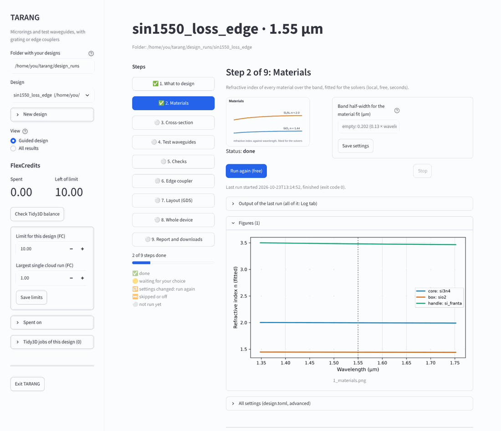
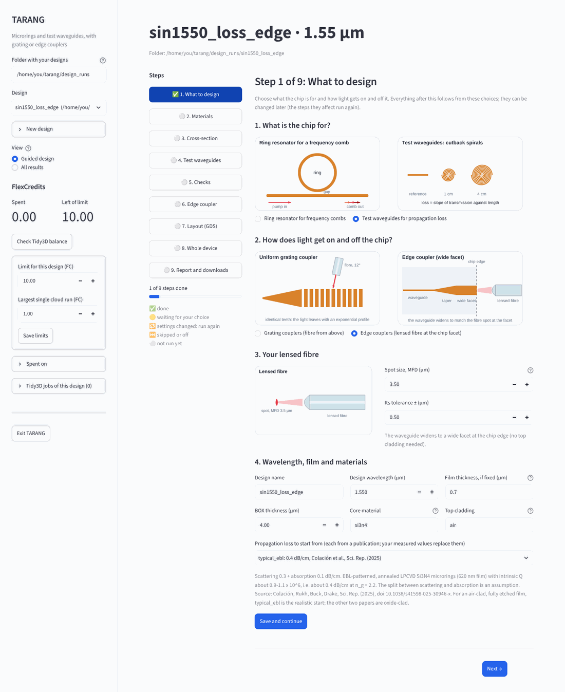
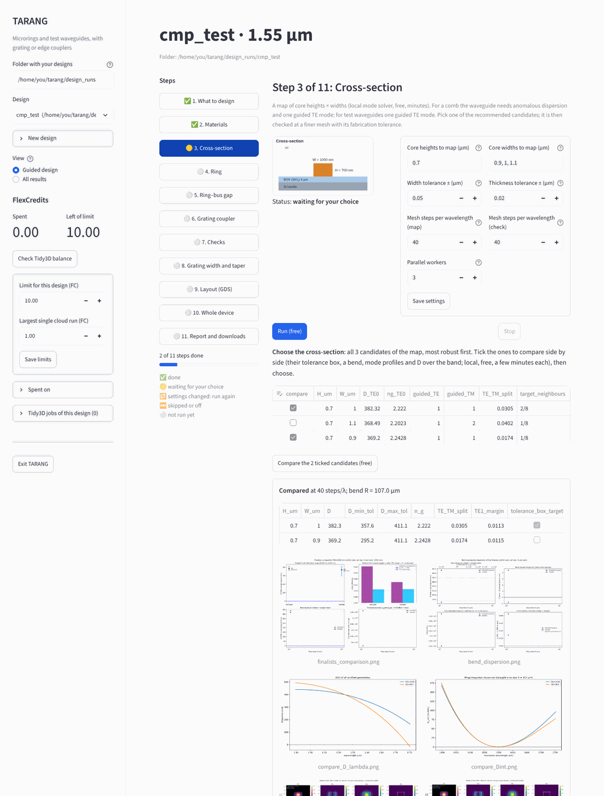
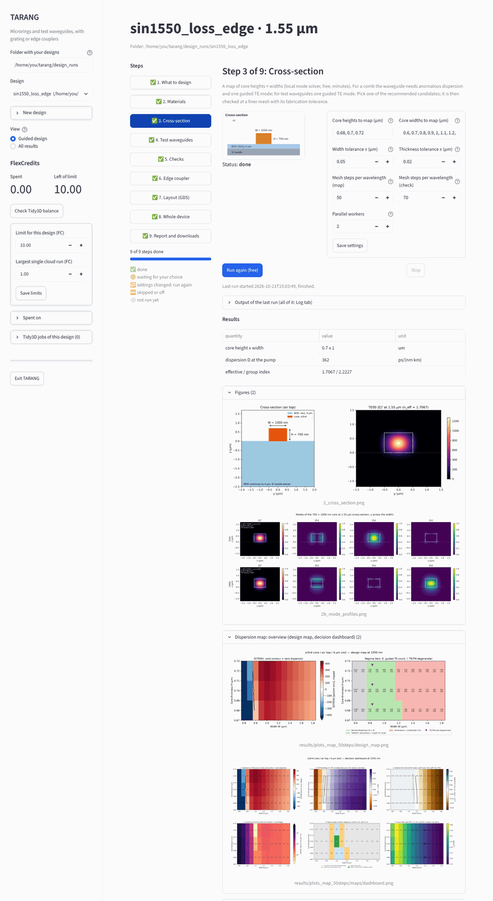
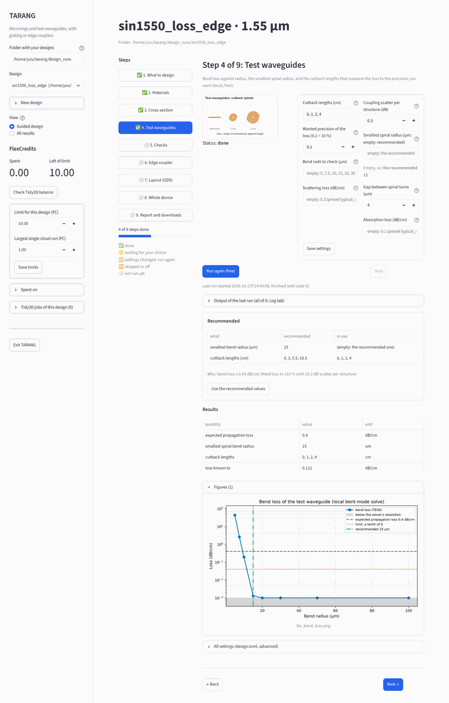
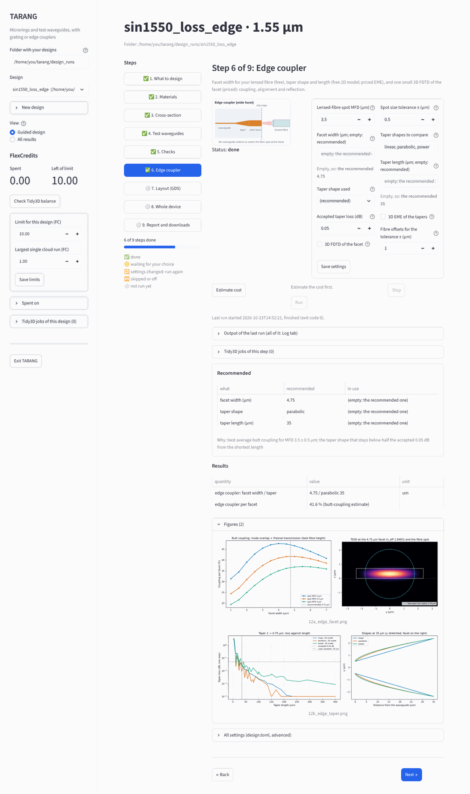
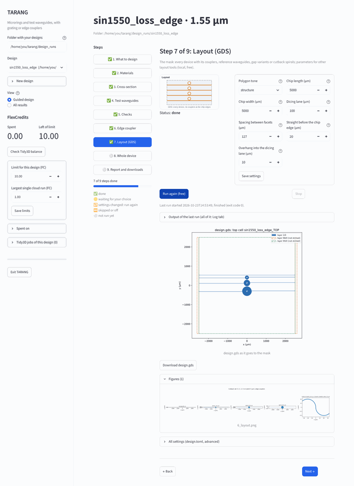
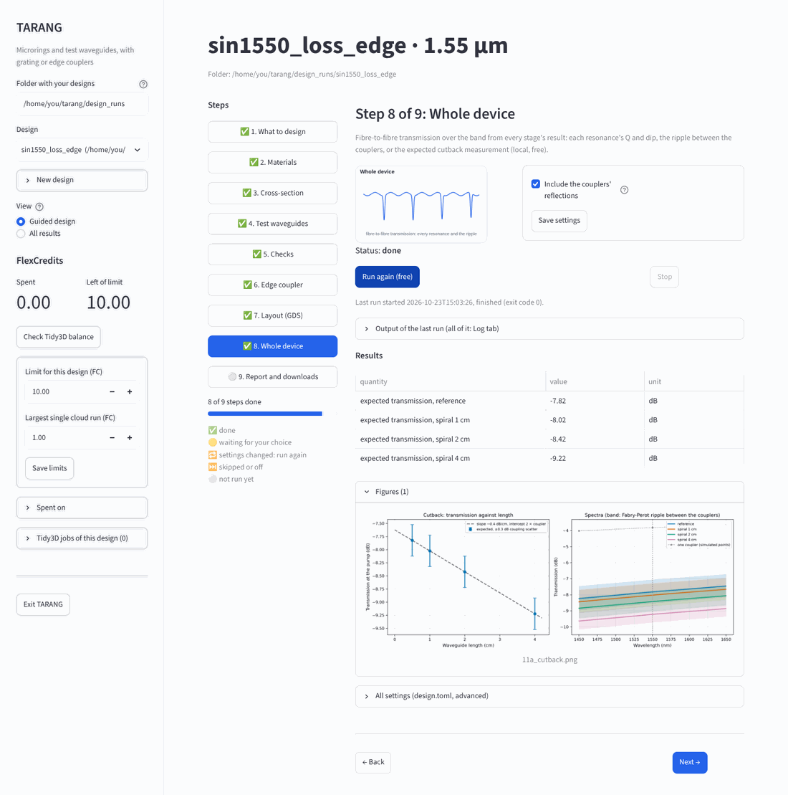
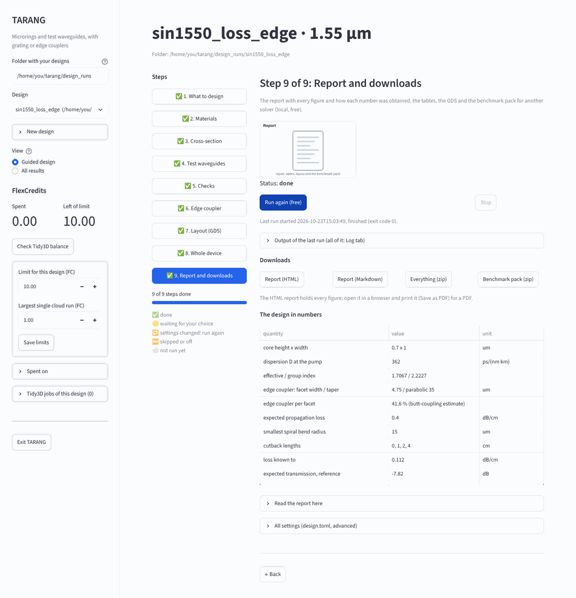

# TARANG user guide

This guide takes you through a design in the browser GUI. It starts from what each step
computes and why, then what you set, what you get back and which numbers to check. The
same steps run from a terminal with `python -m tarang.design`; the
[README](../Readme.md#guided-design-one-command) lists every command.

Two example designs are followed:

- **Path A: a microring for Kerr frequency combs, with grating couplers.** The fibre sits
  above the chip.
- **Path B: test waveguides for propagation loss, with edge couplers.** A lensed fibre sits
  at the chip facet.

Both start from the same stack: a 700 nm Si₃N₄ film on 4 µm of thermal oxide (BOX), with
air above (no top cladding) and the waveguides fully etched. The screenshots come from a
Path B design run with the free steps only.

**Contents**

1. [Before you start](#1-before-you-start)
2. [Start, stop and the screen](#2-start-stop-and-the-screen)
3. [Step 1: what to design](#3-step-1-what-to-design)
4. [The steps one by one](#4-the-steps-one-by-one)
5. [Credits and Tidy3D jobs](#5-credits-and-tidy3d-jobs)
6. [Results, files and the benchmark pack](#6-results-files-and-the-benchmark-pack)
7. [Units and common mistakes](#7-units-and-common-mistakes)
8. [The same from a terminal](#8-the-same-from-a-terminal)

---

## 1. Before you start

- **Install TARANG.** [README, Installation](../Readme.md#installation); the conda
  environment `tarang` has everything.
- **Connect Tidy3D.** Run `tidy3d configure` once, with your API key. Only the cloud steps
  need it; the local steps are free and run on your computer.
- **Gather four facts about your chip.** TARANG asks for them, so have them ready:
  - the film thickness and BOX thickness of your wafer;
  - the top cladding (here `air`);
  - your process tolerances (± width, ± thickness);
  - your fibre: the MFD of a cleaved SMF-28 for gratings, or the spot size of the lensed
    fibre for edge couplers.

**Where things are kept.** Every design is a folder holding `design.toml` (the settings)
and everything the design produces:

- `figures/` and `tables/`;
- `layout/` (the GDS);
- `cloud/` (the Tidy3D results, each stored under a fingerprint of its simulation);
- `report.md` and `benchmark_pack/`;
- `state.json` (what has been done).

The GUI and the command line read and write the same folder, so you can use either one on
the same design in turn.

## 2. Start, stop and the screen

**To start**, in the `tarang` environment, from the TARANG folder:

```powershell
python -m tarang.gui
```

The GUI opens in your browser at `http://localhost:8501`. It runs only on your computer.
It shows the designs under `design_runs/`; type another folder at the top left, or start
with `python -m tarang.gui --root D:\my\designs`.

**To stop**, click **Exit TARANG** at the bottom of the left panel; Ctrl+C in the terminal
does the same. If a run is still going, TARANG asks first:

- **Exit, run goes on**: the run keeps going without the GUI. Its output keeps going into
  `gui_log.txt`; open the GUI again to watch it.
- **Stop run and exit**: the run is stopped like Ctrl+C. Finished stages and finished
  cloud runs are kept.

Closing only the browser tab stops nothing.

<p align="center"></p>

**The screen has three parts:**

| Where | What |
|---|---|
| Left panel | Folder and design, **New design**, **View** (Guided design / All results), FlexCredits (spent, left of this design's limit, **Check Tidy3D balance**, the two limits), **Spent on**, **Tidy3D jobs of this design**, **Exit TARANG** |
| Steps | The steps of your design with their status: ✅ done, 🟡 waiting for your choice, 🔁 settings changed (run it again), ⏭️ skipped or off, ⚪ not run yet. Click one to open it. |
| The step | What it computes; a drawing; its settings; **Run**; once run: **Recommended**, **Results**, figures, and for cloud steps **Tidy3D jobs of this step** |

**Every step works the same way:**

1. **Read the drawing and the line under the title.** They say what the step computes and
   whether it is free (local) or costs credits (cloud).
2. **Check the settings.** Hover over ⓘ for the full explanation of a setting. An empty
   field shows, in grey and under it, the value it stands for ("Empty, so: 0.68, 0.7,
   0.72"). Change what you need, then **Save settings**. **All settings** at the bottom
   holds the whole `design.toml`, for the rare setting the form does not show.
3. **Run the step.**
   - A local step has **Run (free)**.
   - A cloud step has **Estimate cost** first. This goes through the step, pricing every
     cloud simulation without running it; local parts do run. Then **Run (up to X FC)**
     runs it, and never spends more than about that estimate.
   - The output scrolls while the step runs. **Stop** works like Ctrl+C: finished work is
     kept.
4. **Read Recommended and Results.**
   - **Recommended** shows what the step recommends and why, next to what is in use. Where
     those are settings, **Use the recommended values** writes them in; run the step again
     to use them.
   - **Results** shows the key numbers, then the figures.
5. **Click Next →.**

**When you change a setting** of a step that has run, the step shows 🔁. Run it again,
then run the steps after it. Nothing already paid for is paid again: an identical cloud
simulation is read from `cloud/`.

**After a step has run**, the values it used are written into `design.toml`. Fields that
were empty then show those values.

**All results** (under View) is the earlier view: choose stages, **Estimate cost**,
**Run**, and tabs with every figure, table, file and the log.

**Your measured values** (under View) is where numbers from your own chips go; see
[Your measured values](#your-measured-values) below.

**The look.** The GUI opens in the lab's dark theme, with the fonts of the lab's software
pages (loaded from Google Fonts; on a PC without internet the system fonts are used).
Figures stay white, as in a paper. `python -m tarang.gui --plain` opens it in Streamlit's
light look instead, e.g. for a projector.

### Your measured values

Until you have a chip, TARANG works with values from publications (the loss presets, n2,
dn/dT), from your wafer order (film and BOX thickness) and from datasheets (the fibre).
Once you measure something, enter it under **View → Your measured values**. Each value
replaces the assumed one, and the report lists it as *measured*, with the source you give
(chip, method, date). Leave a field empty when you have not measured it.

| Field | What it changes |
|---|---|
| **Intrinsic Q** of a ring, *or* **propagation loss** from a cutback | The loss used by the Ring step (and by the cutback design of test waveguides) instead of the preset. A Q holds every loss of the ring, the bend's too: α = 2π n_g / (λ Q_i), and the straight-waveguide part is α minus the computed bend loss. The absorption value is kept; the rest counts as scattering. Use Q_i, not the loaded Q: for an under-coupled resonance with loaded Q_L and dip transmission T₀, Q_i = 2 Q_L / (1 + √T₀). |
| **Insertion loss per coupler** | Shown next to the simulated loss budget in the report; the simulation is not changed. Measure it on the straight reference waveguide: half its fibre-to-fibre loss. |
| Film and BOX thickness, width and thickness scatter, fibre spot or MFD and angle, n2, dn/dT | Replace those settings; tick **measured** so the report gives them your source. |

After **Save measured values**, the steps that use a changed value show 🔁: run them
again. Only the two loss values repeat a step (Ring or Test waveguides, and what follows);
the source and the coupler loss change only the report. In `design.toml` the same values
are under `[measured]`:

```toml
[measured]
source = "chip A2, swept-laser scan and cutback, Nov 2026"
q_intrinsic = 1.2e6          # or: propagation_loss_db_cm = 0.35 (not both)
coupler_loss_db = 5.8
keys = ["stack.core_height_um"]   # settings that hold measured values
```

## 3. Step 1: what to design

<p align="center"></p>

1. **What is the chip for?**
   - **Ring resonator for frequency combs** (`comb_ring`): a ring with its bus waveguide
     and couplers.
   - **Test waveguides for propagation loss** (`loss_test`): cutback spirals of several
     lengths with couplers, and a straight reference.
2. **How does light get on and off the chip?**
   - **Grating couplers.** The fibre sits above the chip, tilted by a few degrees. The
     teeth scatter the guided mode upwards. Easy to align and testable anywhere on the
     wafer, but narrow-band (tens of nm) and a few dB per coupler.
   - **Edge couplers.** The waveguide widens to a wide facet at the polished or diced chip
     edge, and a lensed fibre faces it. Broadband, with a mode overlap and a facet
     reflection set by the spot sizes and the index step. For an air-clad film, the wide
     facet is the option that needs no extra fabrication.
3. **Which grating couplers, or your lensed fibre.**
   - With gratings, the uniform grating is always designed. **Apodised** (teeth that change
     along the grating, so the light leaves with the fibre's Gaussian profile) and
     **Focusing** (curved teeth that focus into the waveguide tip, so no long taper is
     needed) are extra steps.
   - With edge couplers, give the spot size (MFD) of your lensed fibre and its tolerance,
     e.g. 3.5 ± 0.5 µm.
4. **Wavelength, film and materials.**
   - **Design wavelength** (the pump, e.g. 1.550 µm).
   - **Film thickness in µm (0.7 for 700 nm).** Leave it empty to map several heights.
   - **BOX thickness in µm.**
   - **Core and cladding materials.** These are keys of the material database
     (`si3n4`, `sio2`, `air`, ...); [README, Materials](../Readme.md#materials) lists them.
   - **Propagation loss to start from.** The losses are not computed: they depend on your
     process. Each preset is taken from a paper, shown next to it in the list and in full
     below it. Your measured values replace them later (Ring or Test-waveguides step).

| Preset | Total loss | Paper |
|---|---|---|
| `typical_ebl` | 0.4 dB/cm | Colación et al., *Sci. Rep.* (2025): EBL-patterned, annealed LPCVD Si₃N₄ rings, 620 nm film, Q_i ≈ 1 × 10⁶ |
| `annealed_low_loss` | 0.021 dB/cm | Xuan et al., *Optica* 3, 1171 (2016): 600 nm LPCVD, annealed 1150–1200 °C, oxide-clad, Q_i 1.7 × 10⁷ |
| `state_of_the_art` | 0.008 dB/cm | Ji et al., *Optica* 4, 619 (2017): 730 nm, oxide-clad, Q_i 3.7 × 10⁷ |

How each total is split between scattering and absorption is assumed, since the papers
give only the total. For an air-clad, fully etched film, `typical_ebl` is the realistic
start: the sidewalls are bare, and scattering is larger than in the oxide-clad papers.

**Save and continue** checks the values and opens step 2. A value that cannot be right is
refused with the value meant (see [Units](#7-units-and-common-mistakes)).

## 4. The steps one by one

| Step | Path A | Path B | Where it runs |
|---|:-:|:-:|---|
| [Materials](#materials) | ✓ | ✓ | local, seconds |
| [Cross-section](#cross-section) | ✓ | ✓ | local, minutes |
| [Ring](#ring) | ✓ | | local |
| [Test waveguides](#test-waveguides) | | ✓ | local |
| [Ring–bus gap](#ringbus-gap) | ✓ | | cloud |
| [Grating coupler](#grating-coupler), [Checks](#checks), [Grating width and taper](#grating-width-and-taper) | ✓ | | cloud (small) |
| [Apodised](#apodised-and-focusing-gratings) / [focusing](#apodised-and-focusing-gratings) grating | optional | | cloud (small) |
| [Edge coupler](#edge-coupler) | | ✓ | local + cloud (both optional) |
| [Layout](#layout-gds), [Whole device](#whole-device), [Report](#report-and-downloads) | ✓ | ✓ | local |

Checks also runs in Path B: there it gives the fibre-to-fibre loss budget; the ring and
grating checks are left out.

### Materials

**What it computes.** Every solver needs n(λ) and k(λ) of each layer over the band, not
only at the pump. TARANG reads the tabulated data of each material (sources in
`tarang/media/data/SOURCES.md`) and fits it with a pole-residue model over the band
(default ± 0.13 × λ around the design wavelength). Tidy3D needs such a model for its
time-domain simulations. The figure shows the fitted indices; the table
`tables/materials_nk.csv` holds them sampled over the band.

**Check:** the curves are smooth, and n is right at the pump (Si₃N₄ ≈ 2.0 and SiO₂ ≈ 1.44
at 1.55 µm).

### Cross-section

**What it computes.** For a rectangular core of height H and width W on the BOX, the
mode solver gives the guided modes and their effective index n_eff(λ). From n_eff(λ)
follow:

- the group index n_g = n_eff − λ dn_eff/dλ, which sets the ring's FSR;
- the group-velocity dispersion D = −(λ/c) d²n_eff/dλ². Anomalous dispersion (D > 0) is
  what a bright soliton comb needs.

The step maps D and the number of guided modes over a grid of H × W. Each candidate is
then judged by its 8 neighbours on the grid: a cross-section whose neighbours are also
good survives the fabrication tolerance (± width, ± thickness).

**What is wanted:**
- **Path A:** anomalous dispersion and a single guided TE mode family.
- **Path B:** a single guided TE mode, so the loss measured belongs to one mode.

**You choose.** The map stops with 🟡 and lists **every** candidate, most robust first.
Choosing takes three steps:

1. **Tick the candidates you want to compare.** The top four are ticked for you.
2. **Click Compare the ticked candidates** (local, free, a few minutes each). Each ticked
   candidate is solved at the check mesh and shown side by side:
   - D over its ± tolerance box;
   - the TE/TM split and the margin to the second TE mode's cut-off;
   - D and the loss in a bend: the ring radius for your FSR, or for test waveguides the
     spiral radius (`waveguides.bend_radius_um`, else 20 µm at 1550 nm);
   - its TE00/TM00 mode profiles;
   - its D over the band and, for a ring, D_int.

   The table **Compared** gives the numbers; the figures are below it. They are kept in
   `figures/2_candidates/` and `tables/candidates_*.csv`.
3. **Pick one** ("(compared)" marks those you compared) and click **Use this
   cross-section and check it**. The chosen cross-section is solved again at the check
   mesh, with ± its tolerance and in its bend, and its mesh convergence is checked. The
   report gives D over the tolerance box.

From a terminal, the same comparison runs when `cross_section.compare` lists the
candidates (e.g. `compare = ["0.7x1", "0.7x0.9"]`) and the cross-section is still empty.

**The dispersion-engineering suite** comes with the map. It is shown in the step while it
waits for your choice, and kept with the other figures and tables:
- figures in `figures/2_dispersion_map/`, `figures/2_candidates/`,
  `figures/2_finalists/`, `figures/2_mesh_convergence/` and
  `figures/3_dispersion_profile/`;
- tables in `tables/` (e.g. `map_target_geometries.csv`, `finalists.csv`,
  `mesh_convergence.csv`, `dispersion_profiles.csv`);
- the raw solver data in `results/*.jsonl`. It stays there because it makes a repeated
  solve free.

Designs from before 14E keep their `results/plots_*` folders, and the GUI shows those too.
All of it is also in **All results → Figures** and in the zip download.

- **Design map:** D(TE00) over H × W with the zero-dispersion contour, beside the regime
  of every point. The regimes are normal dispersion; target (anomalous, one TE mode);
  anomalous but multimode; and TE/TM near-degenerate (▽).
- **Decision dashboard:** the nine maps below on one page.
- **The nine maps:**

  | Map | What it shows | Why it matters |
  |---|---|---|
  | 1. Dispersion D of the pump mode | with the D = 0 contour | anomalous (D > 0) is what a bright soliton needs |
  | 2. TE/TM splitting n_TE0 − n_TM0 | < 0: TM is the fundamental mode; within ± 0.01 (dashed) TE and TM hybridise | avoided crossings and polarisation conversion in bends |
  | 3. Distance from the 2nd TE mode's cut-off | n_cut − n_TE1, with the TE1 and TM1 cut-off lines | > 0: TE1 is not guided, so the waveguide is single-mode |
  | 4. Sensitivity of D to a width error | \|∂D/∂W\| | lithography tolerance |
  | 5. Sensitivity of D to a thickness error | \|∂D/∂H\| | film-thickness tolerance |
  | 6. Robust design window | target points whose four neighbours (± 100 nm in W, ± 50 nm in H) are also targets | robust to both errors at once |
  | 7. Group index n_g | sets FSR = c / (2π n_g R) | ring radius for the FSR |
  | 8. Kerr coefficient γ = 2π n₂ / (λ A_eff) | higher γ, lower comb threshold | |
  | 9. Core confinement Γ | power fraction in the core | more field outside means more sidewall scattering |

- **D and the guided modes against width (one figure per height) and against height
  (one per width).**
- **Map 10: which polarisation is anomalous.** Cells coloured by whether TE00, TM00, both
  or neither have D ≥ 0, with both zero-dispersion contours (TE solid, TM dashed) and the
  guided TE/TM mode counts. At short wavelengths TM00 is often anomalous where TE00 is not.
- **Every target geometry** in a table, `target_geometries.csv`, with D, β₂, n_g,
  n_eff(TE0), n_eff(TM0) and the guided-mode counts.
- **After the check:** the mesh convergence of D at the chosen cross-section and the
  comparison of the finalists.
- **For the ring (Path A):** the Ring step adds the dispersion profile.

For the 700 nm film at 1550 nm, these maps are why 0.7 × 1.0 µm is the comb waveguide:
D ≈ 374 ± 3 ps/(nm·km) (mesh check, below) and a single TE mode. It is also robust in map 6: its neighbours at
± 100 nm width and ± 50 nm height are targets too. Its D is also the least sensitive to a
width error (map 4, 0.06 ps/(nm·km) per nm). The candidate table ranks by all 8
surrounding grid points instead of map 6's four.

The comparison screenshot (a small 700 nm map, 40 mesh steps per wavelength) shows why the
comparison helps. 0.7 × 0.9 µm
has nearly the same D as 0.7 × 1.0 µm at the centre (369 against 382 ps/(nm·km)). But its
tolerance box reaches down to 295 and touches TE/TM-degenerate points, and its TE/TM split
is 0.017 against 0.031. 0.7 × 1.0 µm stays between 358 and 411 within the tolerance.

In the screenshots of the test-waveguide design, the map of the 700 nm film recommends 0.7 × 0.7 µm (all 8 neighbours
single-mode, TE/TM split 0.0295). The next candidate, 0.7 × 1.0 µm, is as robust and has
almost the same split (0.0293); it was picked here because it is the width of the rings on
the same chip. Both choices are sound; the table lets you weigh such near-ties yourself.

<p align="center"></p>

**Settings:**
- the heights and widths to map. With a fixed film, the heights are the film ± its
  tolerance; the widths default to 0.39–1.16 × λ.
- the mesh: 50 steps per wavelength for the map, 70 for the check, and the mesh ladder of
  the mesh check (`cross_section.mesh_ladder`, default 50, 60, 70, 80, 90);
- whether the grid is snapped to the core edges (`cross_section.snap_grid`, on; a design
  whose cross-section was computed before keeps it off, so its numbers stay, until you set
  it to `true`);
- the parallel workers (about 1.5 GB of memory each);
- the **pump mode**, TE00 (default) or TM00 (`cross_section.pump_mode`). At short wavelengths
  TM00 is often anomalous where TE00 is not (map 10). With TM00 the map's targets are
  judged by TM00, which must be anomalous and the only guided TM mode. They are ranked by
  how far TM00 lies in index from the nearest guided TE mode, because it hybridises where
  it crosses one. The check, the ring, the gap and the LLE inputs then
  follow TM00. The couplers and the layout are designed for TE00 only so far, so a TM00
  design runs materials, cross-section, ring, test waveguides and gap.

**Check:** n_g and D at the pump, and that the mode figures show one TE00 mode confined
in the core.

**How exact is D?** D is a second derivative of n_eff(λ), so small mesh errors are
amplified. The mode solver's n_eff moves by about 10⁻³ from one grid to the next, even as
the grid is refined, and D does not settle monotonically. The largest part comes from
where the core edges fall in their cells. With `snap_grid` (on by default), grid lines go
through the four core edges, and the spread of D over the mesh ladder drops about four
times. For 700 × 1000 nm at 1550 nm:

| | 50 | 60 | 70 | 80 | 90 | 100 | median ± spread |
|---|---|---|---|---|---|---|---|
| not snapped | 378.7 | 373.6 | 361.6 | 372.5 | 374.6 | | 373.6 ± 12.0 |
| snapped | 374.0 | 374.0 | 376.8 | 373.8 | 370.9 | 373.7 | 373.9 ± 3.0 |

So quote D as the mesh check's **median ± spread** (report, key numbers and
`tables/mesh_band.csv`), not as the value at one mesh.

<p align="center"></p>

### Ring

*Path A only.*

**What it computes:**
- **Radius.** For a free spectral range FSR, R = c / (2π n_g FSR), rounded to 0.5 µm.
- **Intrinsic Q.** From the propagation loss α (scattering + absorption + bend), Q_i =
  2π n_g / (λ α), with α in 1/m of power. For example, 0.4 dB/cm = 9.2 m⁻¹ gives
  Q_i ≈ 1 × 10⁶ at n_g = 2.22.
- **Bend loss** at R, from a bent-mode solve.
- **Integrated dispersion** D_int(μ) of the ring modes, from a broadband solve; the
  `lle/` files give it in pyLLE's format for comb simulations.
- **Dispersive waves.** A soliton comb sheds light where its lines are phase-matched to the
  ring's resonances, D_int(μ) = 0 away from the pump. These wavelengths are marked on the
  D_int panel and listed in the report (to first order: the Kerr shift moves them slightly
  towards the pump).
- **Effective area and Kerr coefficient over the band:** A_eff(λ) and γ(λ) = 2π n₂ /
  (λ A_eff) of TE00 (`figures/3_dispersion_profile/gamma_*.png`).
- **Resonance shift with temperature,** dλ/dT = (λ / n_g) dn_eff/dT. dn_eff/dT is the
  thermo-optic coefficients weighted by where the mode's power is: Si₃N₄ 2.45 × 10⁻⁵ /K and
  SiO₂ 0.95 × 10⁻⁵ /K (Arbabi and Goddard 2013). Only the core fraction is known, so the
  report gives a range, from the rest of the power in air to the rest in the BOX. For
  700 × 1000 nm at 1550 nm this is about 14–15 pm/K. It sets how far the thermal triangle
  drags the resonance when you scan the pump into it.

**A soliton from this design (proof, outside TARANG).**
`validation/pylle_soliton/run_pylle.py <design folder>` hands the `lle/` files to pyLLE. It
runs the detuning sweep at 4× the threshold and saves the soliton steps, the comb spectrum
and the intracavity pulse. It needs Julia ≥ 1.8 and `pip install pyLLE`; the top of the
script says how. TARANG itself does not depend on either.

**Settings:**
- the FSR;
- the radius (empty: from the FSR);
- the losses: a preset, your own scattering and absorption values, or a measured Q_i or
  cutback loss from [Your measured values](#your-measured-values), which replaces both.

### Test waveguides

*Path B only.*

**What it computes.** The cutback method measures the fibre-to-fibre transmission T(L) of
waveguides of several lengths with identical couplers. The slope of T (dB) against L is
the loss α. Its precision depends on how far apart the lengths are and on how much the
coupling scatters from one structure to the next (σ, set by fibre placement and facet
quality):

σ_α = σ / √Σ(L − L̄)²

So long, widely spaced lengths beat many short ones. Lengths of 0, 1, 2, 4 cm with
σ = 0.3 dB give σ_α ≈ 0.10 dB/cm, which is ±25 % of 0.4 dB/cm. Lengths of 0, 3, 5.5,
10.5 cm give ±10 %.

The step finds:
- the bend loss against radius;
- the smallest spiral radius whose bend loss is below a tenth of the expected
  propagation loss;
- the lengths that reach your wanted precision.

**Use the recommended values** writes the radius and the lengths into the settings.

**Settings:**
- the lengths;
- the coupling scatter σ;
- the wanted precision;
- the bend radii to check;
- the gap between spiral turns.

<p align="center"></p>

### Ring–bus gap

*Path A, cloud.*

**What it computes.** The power the bus couples into the ring per pass, κ², depends
exponentially on the gap. Critical coupling (κ² equal to the round-trip loss) gives the
deepest dip. Over-coupling with K = Q_i/Q_c > 1 (default 1.5) gives a wider, more robust
resonance, which is what comb generation usually wants.

A 3D FDTD of an arc of the ring next to the bus at a few gaps gives κ²(gap). A fit gives
the critical and over-coupled gaps.

**Settings:**
- the gaps to simulate;
- K;
- the arc angle;
- the mesh.

### Grating coupler

*Path A, cloud.*

**What it computes.** A grating of period Λ couples the guided mode to light leaving at
angle θ when the phase matches: n_B − λ/Λ = n_top sin θ (first order; n_B is the Bloch
index of the grating). 2D FDTD of the grating with the fibre's Gaussian beam searches the
period, fill factor and fibre position for the highest coupling at the design wavelength.

**Settings:**
- full or partial etch;
- the fibre angle and tilt direction;
- the fibre MFD;
- the number of teeth;
- the smallest feature your lithography makes.

### Checks

*Path A: cloud (small runs).*
- the fabrication tolerance of the gaps;
- the coupling across the band (3D FDTD);
- the ring's mode families (do higher-order families cross the TE00 family?);
- the grating's tolerance to angle and lithography bias, and its back-reflection;
- with `checks.angle_sweep_deg` (e.g. `[8, 10, 14, 16]` around a 12° stage), the grating's
  efficiency against the fibre angle, each peak set beside the grating equation's
  prediction (figure `7d_grating_angle`).

*Path B:* the fibre-to-fibre loss budget at the design wavelength.

### Grating width and taper

*Path A.*
- **Grating width.** The lateral overlap of the fibre's Gaussian with the grating's lateral
  mode sets the grating width; the 3D efficiency is about η_2D × η_y.
- **Taper length.** A free 2D model and one 3D EME give the taper's loss against length.
  The shortest taper below the accepted loss is used.

### Apodised and focusing gratings

*Path A, optional.*
- **Apodised grating.** Teeth that change along the grating so the emitted profile matches
  the fibre's Gaussian; the uniform grating's ceiling is about 80 % overlap.
- **Focusing grating.** Curved teeth that focus into a short taper. The better design is
  used on the mask (`layout.coupler`).

### Edge coupler

*Path B. Local, plus two priced parts.*

**What it computes.** Three things, in order:

1. **Facet width (free).** By reciprocity, the coupling of the lensed fibre's spot into the
   waveguide equals the overlap of the facet's TE00 mode with the fibre's Gaussian, times
   the Fresnel transmission of the facet: 1 − ((n_eff − 1)/(n_eff + 1))². The step maps
   this over facet width and fibre height for your MFD ± tolerance and picks the width
   with the best average.
   - Figure 12a. For 3.5 µm on 700 nm Si₃N₄: about 4.75 µm and 42 % per facet.
   - The film is thin, so the mode is flatter than the spot. That mismatch in height, not
     the width, limits the coupling.
2. **Taper (free model; EME priced).** The linear, parabolic and power-law tapers from the
   waveguide to the facet. The length is the shortest one from which the loss stays below
   half the accepted loss (figure 12b).
3. **Facet in 3D FDTD (priced).** The waveguide runs through the absorbing
   boundary, and the field just outside the facet gives, by reciprocity:
   - the coupling for any fibre offset, spot size and working distance;
   - the facet reflection, from the backward mode amplitude (figure 12c).

**Settings:**
- the MFD and its tolerance;
- the facet width, taper shape and length (each empty means the recommended one);
- the accepted taper loss;
- whether to run the EME and the 3D check;
- the fibre offsets for the tolerance;
- the chip size, dicing lane and pitch, used by the layout.

<p align="center"></p>

**Check:**
- the coupling per facet;
- the alignment tolerance (offset for −1 dB);
- the facet reflection: it makes the chip a Fabry–Perot cavity, seen in Whole device.

### Layout (GDS)

**What it draws.** `layout/design.gds` holds every device with its couplers:
- **Path A:** the ring with its bus, a reference waveguide and gap variants.
- **Path B:** the cutback spirals of the exact lengths and the straight reference. For edge
  coupling, the waveguides run facet to facet across the chip, with the chip outline and
  dicing lanes on their own (unetched) layers.

`layout/parameters.json` holds every dimension for other layout tools. The step shows
the GDS as it goes to the mask, with **Download design.gds**.

<p align="center"></p>

**Check (in KLayout too):**
- the layer numbers match your mask house's;
- the polygon tone (`layout.tone`: structure or trench) matches your resist;
- the spacing between devices.

### Whole device

**What it computes.** Fibre-to-fibre transmission over the band, from each part's own
result joined as a circuit: couplers, tapers, waveguide loss, the ring as an all-pass
filter with its real resonance frequencies, and the couplers' reflections. Two reflecting
couplers make a Fabry–Perot cavity of the chip length L: the transmission ripples with
period λ²/(2 n_g L), e.g. 108 pm for 5 mm.

- **Path A:** every resonance's Q_i, Q_c, Q_L, K and dip for the critical and over-coupled
  gaps.
- **Path B:** the expected cutback line and each structure's spectrum.

Compare these with your measurement.

<p align="center"></p>

### Report and downloads

The last step writes `report.md`, which says how every number was obtained, with every
figure, and the benchmark pack. Downloads:

- **Report (HTML)**: one page with all figures. Open it in a browser and **Print → Save as
  PDF** for a PDF.
- **Report (Markdown)**.
- **Everything (zip)**: settings, report, figures, tables, layout and the benchmark pack,
  without the cloud data.
- **Benchmark pack (zip)**.

<p align="center"></p>

## 5. Credits and Tidy3D jobs

**What runs where.**
- **Local steps** (mode solves, models, layout, report) are free.
- **Cloud steps** run 2D/3D FDTD or EME on Tidy3D and cost FlexCredits (FC).

**Before any cloud run:**
- Every cloud simulation is priced first. A run above a limit is deleted unstarted, and
  nothing is charged.
- Each design has two limits (left panel): the **total** for this design and the
  **largest single run**. Neither can be set above your account balance (**Check Tidy3D
  balance**).
- In a step, **Estimate cost** lists every cloud simulation the step needs. **Run (up to
  X FC)** then spends at most about that estimate (a 5 % margin).

**Re-running is free.** An identical simulation (same fingerprint) is read from `cloud/`
and never paid twice. A run interrupted on your side keeps running on Tidy3D, and the
next run picks it up.

**The jobs and their links.**
- **Tidy3D jobs of this step** (in each cloud step) and **Tidy3D jobs of this design**
  (left panel) list every simulation: its name, status, estimate, billed cost and date.
- **open ↗** opens the simulation in the Tidy3D web interface, where you see the set-up,
  mesh, monitors and results (log in with your Tidy3D account).
- Runs saved before TARANG kept task records have no link. **Find the missing links**
  asks Tidy3D for them.
- **Spent on** (left panel) lists what was spent per stage.

## 6. Results, files and the benchmark pack

| File | What |
|---|---|
| `design.toml` | every setting, with its explanation; rerun exactly with `python -m tarang.design --config design.toml --yes` |
| `report.md` | every result with how it was obtained, the assumed values with their sources, known limits |
| `figures/`, `tables/` | every figure (PNG and PDF) and table (CSV); next to each figure its plotted numbers (`<name>_data.csv`, maps in `<name>_data.npz`) and its labels, versions and settings (`<name>_meta.json`) |
| `figures_paper/` | journal-sized copies of the figures, when `run.figure_style = "paper"` (below) |
| `layout/` | `design.gds`, `parameters.json`, `spirals.csv`, `chip.json` |
| `lle/` | comb-simulation inputs (Path A) |
| `benchmark_pack/` | everything another solver needs to repeat the design (below) |
| `cloud/` | the Tidy3D results, each with `simulation.json` and `task.json` (link) |

**Figures for a paper.** Every figure comes with its numbers, so it can be redrawn in any
plotting program. `<name>_data.csv` has one row per plotted point: `panel` (0, 1, … left to
right, top to bottom), `series` (the legend name), `kind` (line, points, bars, errorbar,
hline, vline), `x`, `y`, `z` (the colour value of coloured points), `lo` and `hi` (error-bar
ends). The axis labels and units are in `<name>_meta.json`. For journal-sized figures (3.4 in
wide for one column of panels, 7 in otherwise; text 6–8 pt by role; panel letters (a), (b),
…; long titles and notes moved to the caption in the JSON under those letters; legends kept
off the data), set
`run.figure_style = "paper"` and run the steps again with `--redo`. Every cloud simulation
is read from its saved results, so this costs nothing as long as no other setting changed
(a design made before Phase 15A keeps `snap_grid = false` by itself, so its cross-section
and everything built on it stay the same). The copies go to `figures_paper/`, and
`figures/` stays as it was.

**The benchmark pack** lets another group or another solver check every number:

| File | What |
|---|---|
| `README.md` | the stack, materials, every simulation with its dimensions, mesh, boundaries, sources and monitors, the results and what to compare; the TARANG and Tidy3D versions |
| `materials_nk.csv` | n and k exactly as used (import these rather than a solver's built-in materials) |
| `assumptions.csv` | every assumed value with its source |
| `results.csv` | every computed value with how it was computed |
| `comparison.csv` | the same values with empty columns `your_value`, `your_solver_and_settings`, `difference_pct`, `notes`, to fill in and send back |
| `simulations/` | the exact simulation files used |
| `figures/`, `tables/`, `layout/` | copies of the run's |

## 7. Units and common mistakes

| What happened | Why, and what to do |
|---|---|
| "Film thickness 700 µm is outside 0.02–5 µm …; did you mean 0.7 µm (700 nm)?" | **Every length in TARANG is in µm.** Type 0.7 for a 700 nm film. Values outside a plausible range (film, BOX, core height and width, fibre spot) are refused in the GUI, and a run stops before its first stage. |
| A step shows 🔁 | A setting it depends on changed since it ran. Run it again, then the steps after it; nothing is paid twice. |
| "Needs the earlier step(s) first" | Its inputs come from those steps. Run them first. |
| Run is greyed out | A run of this design is going, or a setting cannot be right (red box at the top of the step). |
| A cloud step skipped a simulation | Its estimate was above a limit (left panel) or above the step's estimate. Raise the limit or estimate again. |
| A figure does not change after a rerun | The browser shows the old image; reload the page. |
| Checks shows 🔁 in a copied design | The copy's settings differ from the design that ran the checks. Rerunning repeats its cloud runs unless the copy also has the `cloud/` folder. |

## 8. The same from a terminal

Every step is a stage of `python -m tarang.design`. The GUI starts exactly these commands
in the background, so the two give the same results:

```powershell
python -m tarang.design --config design_runs\my_design\design.toml --price-only        # estimates only
python -m tarang.design --config design_runs\my_design\design.toml --only materials,cross_section
python -m tarang.design --config design_runs\my_design\design.toml --only edge --redo edge
python -m tarang.design --config design_runs\my_design\design.toml --credits           # spent, per stage
```

`--price-only` runs every free step for real and prices the cloud ones. A stage whose priced
runs it left out is not marked done, so the next run without `--price-only` does that stage
again and runs what is missing (its finished cloud runs come back from the cache, free). The
same holds for runs left out by `--spend-cap`, the budget or a skip.

In a terminal, each stage shows one table of its settings: Enter accepts them, a number
changes one, `?` explains, and `q` stops. [README, Every
command](../Readme.md#every-command) has the full list.
